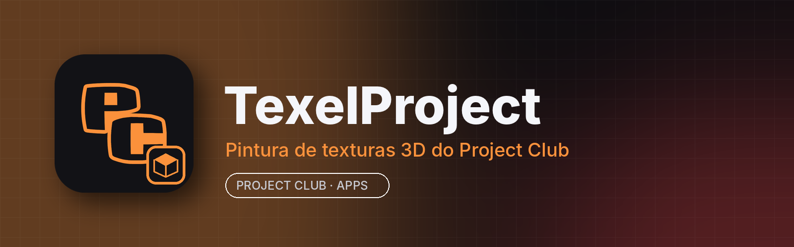

<p align="center"></p>

# TexelProject

**TexelProject** é o app de **pintura de texturas 3D** do **Project Club**: importe um modelo 3D e pinte direto nele com materiais PBR (cor, rugosidade, metal, relevo), camadas, máscaras e pincéis — e exporte as texturas para jogos, mods e renders. Integrado à aba **Apps** do Project Club.

É uma versão modificada do **[ArmorPaint](https://armorpaint.org)** (código aberto, licença zlib). Todos os recursos do ArmorPaint continuam aqui; o TexelProject troca o nome, o ícone, o tema e a integração com o Project Club.

## Principais recursos

- Pintura em tempo real sobre modelos 3D (OBJ, FBX, glTF/GLB, BLEND)
- Materiais PBR e editor de nós para materiais e pincéis
- Camadas, grupos, máscaras e modos de mistura
- Pincel, borracha, preenchimento, decalques, texto, clonagem, desfoque e seleção por cor
- Vista 2D da textura e vista 3D com iluminação HDR
- Exporta texturas PNG/JPG/EXR com predefinições (Unreal, Unity, glTF...)
- Path tracing para pré-visualização (em GPUs compatíveis)
- Tema escuro do Project Club com destaque laranja

## Instalar

Pelo **Project Club**: aba **Apps → TexelProject → Instalar**. Manual: [Releases](../../releases/latest)
- **Windows 10/11 (64 bits):** `TexelProject-<versão>-win.zip` → extraia e abra `TexelProject.exe`
- **Linux (x86_64):** `TexelProject.AppImage` → `chmod +x` e execute (precisa de driver Vulkan)

## Requisitos

| | Mínimo | Recomendado |
|---|---|---|
| Sistema | Windows 10 64 bits / Linux x86_64 com Vulkan | Windows 11 / Ubuntu 22.04+ |
| CPU | 4 núcleos | 6+ núcleos |
| RAM | 4 GB (o app usa ~0,8–2 GB) | 8–16 GB |
| GPU | Direct3D 12 (Windows) / Vulkan 1.1 (Linux), 2 GB de VRAM | 4 GB+ de VRAM, com ray tracing para o path tracer |
| Disco | ~150 MB + projetos | SSD |

## Compilar

```bash
cd paint
../base/make --compile        # Linux: precisa de clang, Vulkan, GTK3 e ALSA (veja base/docs/linux_deps.md)
```
No Windows, `..\base\make --compile` (Visual Studio com as ferramentas clang). O workflow **Build TexelProject release** gera os pacotes do Project Club, as capturas de tela e a release.

## Créditos e licença

TexelProject é uma **versão alterada** do ArmorPaint, © Lubos Lenco e colaboradores, licença **zlib/libpng** — veja [license.md](license.md). Este software não é o ArmorPaint original e não é afiliado ao projeto ArmorPaint. README original: [docs/readme-ArmorPaint-original.md](docs/readme-ArmorPaint-original.md).
